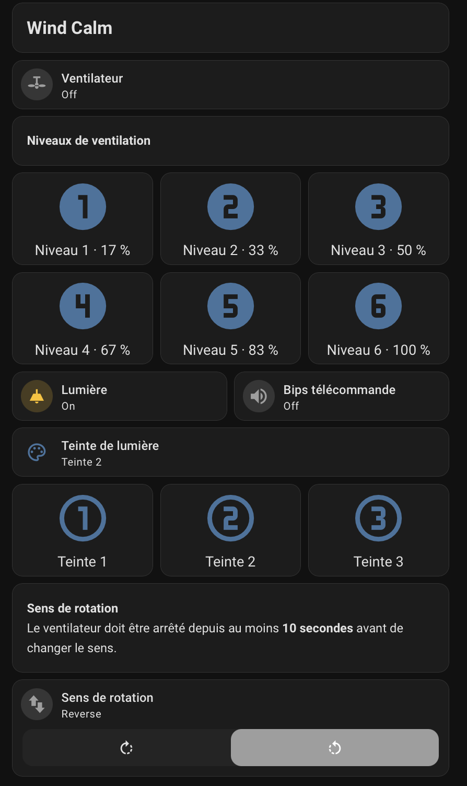

# Wind Calm Matter pour Home Assistant

L'objectif du projet est de **remplacer le module Wi-Fi d'origine** du
ventilateur CREATE Wind Calm par une connexion **Matter sur Thread**, adaptée
à une intégration locale dans Home Assistant, **sans dépendance au cloud**.

Un peu de modification matérielle — un **Seeed XIAO ESP32-C6** et une alimentation
adaptée — et ce firmware permettent de piloter le ventilateur depuis HA, tout
en conservant la télécommande d'origine. Le contrôleur conserve la gestion du
moteur et de la lampe ; le XIAO utilise Thread, sans Wi-Fi ni cloud Tuya.

## Au quotidien

- Allumer, éteindre et choisir parmi **six vitesses** de ventilation.
- Allumer ou éteindre la lumière.
- Changer le sens de rotation, après arrêt confirmé pendant au moins **10 secondes**.
- Activer ou couper les bips de la télécommande.
- Retrouver dans HA les états remontés par le contrôleur, y compris à la télécommande.
- Mettre le firmware à jour **à distance par OTA**, après la première installation USB.

  

*Interface Home Assistant du mainteneur. La présentation peut être adaptée.*

**À propos des teintes :** les trois commandes sont présentes, mais le panneau
LED d'origine peut changer de couleur au ON/OFF. Une commande « Teinte 1 » ne
correspond pas nécessairement à une couleur fixe.
[Comprendre cette limite](docs/HARDWARE.md#limite-du-panneau-led).

## Ce qu'il faut

- Un Wind Calm compatible avec le contrôleur et le câblage décrits dans le projet.
- Un XIAO ESP32-C6 et une **alimentation régulée indépendante de 5 V** pour le montage documenté.
- Home Assistant avec Matter et un **routeur de bordure Thread**.
- Un accès USB pour installer le firmware une première fois.

Le montage nécessite une modification matérielle. Il a été testé sur un
exemplaire ; la compatibilité avec toutes les variantes Wind Calm n'est pas
garantie. [Voir le matériel, les connexions et les photos](docs/HARDWARE.md).

## Installer et utiliser

1. Consulter le [montage matériel](docs/HARDWARE.md).
2. [Compiler le firmware](docs/DEVELOPMENT.md#compiler-le-profil-actif), puis suivre
   la [première installation USB](firmware/WindCalmThreadOTA/USB-RECOVERY.txt).
3. Appairer le XIAO à Matter dans HA et [adapter la carte Home Assistant](home-assistant/INSTALLATION.txt).
4. Pour les mises à jour suivantes, suivre la [procédure OTA](home-assistant/MAINTENANCE.txt).

Un [exemple de carte YAML](home-assistant/wind-calm-card.yaml) est également
fourni. Adaptez sa présentation et remplacez les identifiants par vos entités.

## Documentation

- [Développement, compilation et tests](docs/DEVELOPMENT.md).
- [Maintenance, diagnostics et récupération USB](home-assistant/MAINTENANCE.txt).
- [Portée des validations](VERIFICATION.txt) et [vérifications avant installation définitive](PRODUCTION.txt).
- [Sécurité et contact privé](SECURITY.md).

Les mises à jour OTA conservent l'appairage lors d'une mise à jour compatible.
Une panne matérielle ou un appareil devenu injoignable peut toutefois nécessiter
un accès physique. Le projet est communautaire, sans certification Matter ou
qualification industrielle revendiquée.

## Réalisation et licence

Le logiciel, les outils, les tests automatisés et la documentation ont été
réalisés par **OpenAI Codex**, sous la direction du mainteneur. Le mainteneur a
réalisé et vérifié le montage matériel et le fonctionnement sur son exemplaire.
Il ne s'agit pas d'une revue de code indépendante.

Le travail s'appuie sur les observations de
[christiaanderidder/esphome-create-wind-calm](https://github.com/christiaanderidder/esphome-create-wind-calm).
[Sources et crédits](SOURCES.md) · [Licence MIT](LICENSE) · [Licences tierces](LICENSES.txt).
