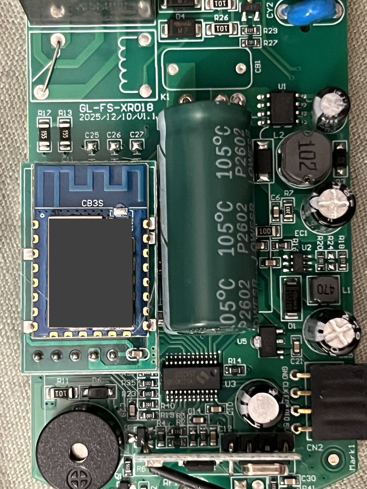
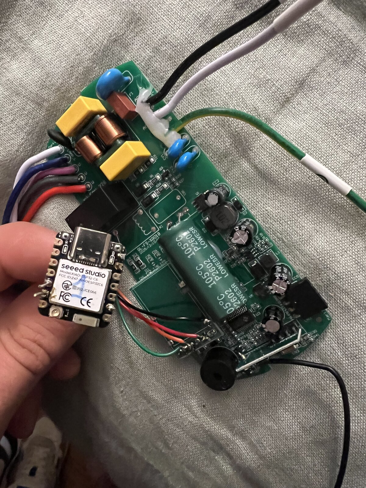
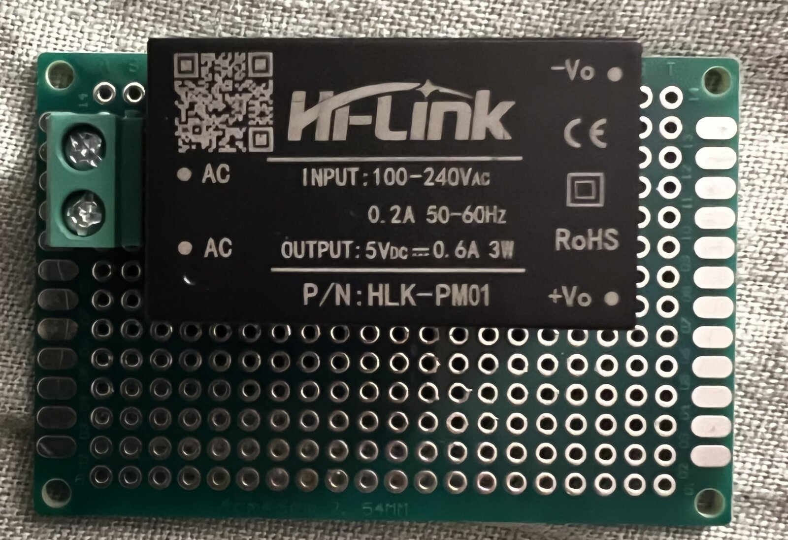

# Matériel et retour de montage

Ce retour concerne un seul exemplaire de CREATE Wind Calm. Les variantes de
carte, d'alimentation et de panneau LED ne sont pas interchangeables sans
vérification. Le mainteneur a réalisé les soudures, les vérifications électriques
et les essais fonctionnels ; Codex a développé le logiciel, les outils et la
documentation à partir de ses observations et essais. Il n'y a pas de revue
indépendante ni de certification électrique ou Matter revendiquée.

## Carte d'origine

Photo fournie par le mainteneur : module réseau CB3S encore présent et marquage
de carte GL-FS-XR018 / V1.1 visible. Le récepteur RF et le contrôleur moteur/lampe
restent en place pendant la conversion. Le marquage identifiant du CB3S a été
masqué sur la copie publique ; ce masquage ne représente pas une modification
électronique.

## Étape de remplacement par le XIAO

Cette photo montre une étape de prototype après retrait du CB3S, avec le XIAO
relié par fils. Elle ne représente pas le montage final et ne doit pas servir
à déduire les connexions par couleur des fils.

Le profil actif utilise les connexions UART suivantes, à 9600 bauds :

| Signal côté contrôleur | XIAO ESP32-C6 |
| --- | --- |
| RX du contrôleur, ancienne ligne TX du CB3S | D4 / GPIO22 / TX |
| TX du contrôleur, ancienne ligne RX du CB3S | D5 / GPIO23 / RX |
| Référence logique GND du contrôleur | GND commun |
| Sortie +5 V de l'alimentation indépendante | Broche 5V / VBUS |
| Sortie négative de l'alimentation indépendante | GND |

Les GPIO UART sont en logique 3,3 V. Le +5 V ne va pas sur un GPIO ni sur la
broche 3V3. Le CB3S est retiré afin de ne pas faire piloter l'UART par deux
modules. Ne pas relier en parallèle le positif de l'ancienne alimentation et
celui de la nouvelle. Le GND commun décrit ici est une référence de signal,
pas une connexion à la terre de protection.

## Alimentation indépendante utilisée

Le module photographié est un **Hi-Link HLK-PM01**. Son étiquette indique une
entrée 100–240 V AC et une sortie 5 V DC, 0,6 A, 3 W. La photo montre le
composant sur une plaque de prototypage, pas le câblage secteur terminé, la
face soudure, les protections ou le boîtier final. Elle n'est pas un plan
d'assemblage secteur ni une preuve de conformité de cette réalisation.

Le montage documenté utilise cette alimentation indépendante pour le XIAO.
Ne pas supposer que l'alimentation de la carte d'origine peut fournir le courant
nécessaire : les variantes doivent être vérifiées individuellement.

Le mainteneur indique que les ajouts ont finalement été placés **à l'extérieur
du boîtier d'origine**. Aucune photo de cette réalisation finale n'est disponible :
fixation, enveloppe, séparation secteur/basse tension, passage des fils et
comportement thermique ne sont donc pas évaluables à partir des photos publiées.
Toute reproduction touchant au secteur nécessite les compétences et vérifications
adaptées ; la validation du mainteneur ne s'étend pas au montage d'un tiers.

## Limite du panneau LED

Le mainteneur rapporte que :

- un OFF/ON peut changer la teinte depuis HA comme depuis la télécommande ;
- la séquence « Teinte 1 → Teinte 2 → Teinte 1 » ne restitue pas toujours la même
  couleur physique.

DP23 et le sélecteur HA ne permettent donc pas de promettre une couleur absolue,
une température Kelvin ou un retour fidèle de la couleur réelle. L'état ON/OFF
et la couleur sont deux informations distinctes. Les essais concordants de
lumière après OTA ne valident pas une sélection absolue de teinte.

[L'auteur de la conversion ESPHome décrit le cycle de trois températures comme
une fonction du panneau LED](https://github.com/christiaanderidder/esphome-create-wind-calm#light-cycles-between-3-light-temperatures).
Il rapporte avoir monté un panneau blanc chaud à teinte unique d'environ
11–12 cm, en réutilisant les pieds aimantés d'origine. Cette observation est
cohérente avec les symptômes rapportés ici ; elle ne constitue pas une analyse
électrique du panneau de cet exemplaire. Aucun remplacement du panneau LED ni
contournement logiciel de ce cycle n'a été validé dans ce projet.

## Photos et portée de la validation

Les trois photos proviennent du mainteneur et sont publiées avec son accord pour
documenter ce projet, sous la licence du dépôt. Les copies publiques sont
réorientées, réduites et dépourvues de métadonnées EXIF/GPS/commentaires. Le seul
masquage de contenu concerne le marquage identifiant du CB3S ; les connexions ne
sont pas retouchées. Les marques et logos visibles appartiennent à leurs
propriétaires et ne signifient aucun soutien au projet.

Les essais de rollback forcé, récupération de blocage et endurance instrumentée
du montage final restent à qualifier selon
[PRODUCTION.txt](../PRODUCTION.txt). Une publication du code ne signifie pas que
toutes les pannes seront réparables à distance.
